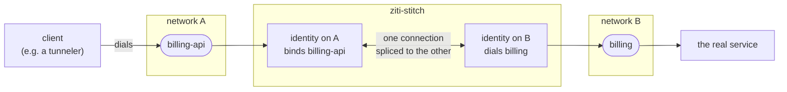
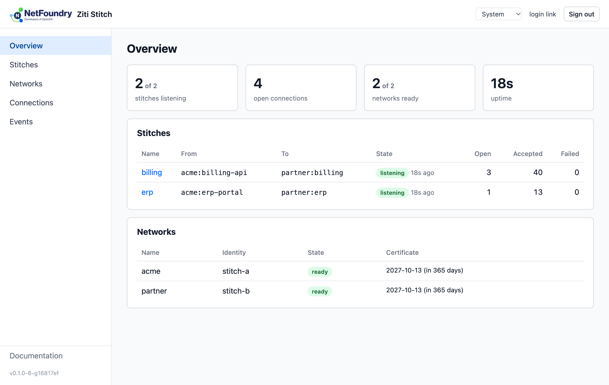

# ziti-stitch

Stitches services across independent [OpenZiti](https://openziti.io) networks.

An identity on network A dials a service that `ziti-stitch` hosts. For each connection, `ziti-stitch` dials a matching service on network B with a second identity and splices the two together. It works with any number of networks and stitches, needs no admin access on any network, and runs as a system service on Linux, macOS and Windows.



Status: early, first released as v0.1.0. Feedback and issues are welcome.

- [Installing and running as a service](docs/install.md)
- [What to ask your network admins for](docs/admin-checklist.md)
- [The web UI](docs/web-ui.md)
- [High availability](docs/high-availability.md)
- [Running in Kubernetes](docs/kubernetes.md) (Helm chart and container image)

## When to use it

OpenZiti has no federation between networks: an identity on one network cannot be granted a service on another. There are two ways to connect clients on network A to a service on network B.

**Give the clients identities on both networks.** Each client enrolls on B as well, and ziti-edge-tunnel and the SDKs run several identities side by side (each network's services need intercepts that don't overlap). B's admin then sees and controls every client in B's own policies, and traffic stays end-to-end encrypted from client to service. Choose this when B needs per-client control, or when nothing between the client and the service may see the traffic.

**Stitch the networks.** The clients stay on A only, and ziti-stitch joins one service on A to one on B:

- **The clients register with one controller.** A's endpoints never enroll on, or talk to, B.
- **B manages one identity, not one per client.** B grants Dial on one service to the stitch's identity, a single front door to B's service. B never sees A's endpoints, and sees A's identities only if the stitch passes on who is calling (below).
- **Each admin keeps control of their own network.** A's admin decides which of A's identities may dial the service; B's admin decides what the stitch may reach. Neither needs any access to the other's controller, and either side can end the arrangement alone by removing its own policy.
- **Adding a stitch takes one command,** where an intermediate tunneler with an identity on each network needs intercept and host configs written by hand for every service. `ziti-stitch validate` checks the policies on both sides.

What a stitch gives up:

- **End-to-end encryption.** Each side's Ziti connection ends at ziti-stitch, so the traffic is decrypted there before it is sent on. It exists in plain form only in ziti-stitch's memory, a buffer at a time as it is copied across, and is never written to disk or logged (only byte counts are). Whoever controls the host could still read it, so run ziti-stitch where both sides trust it, or use TLS inside the connection (HTTPS, for example) to keep the traffic encrypted end to end.
- **Per-client policy on B.** B's policies see only the stitch. With `app_data: annotate` (and OpenZiti 2.0 or later on A), ziti-stitch passes the caller's identity on A to the service on B, so the service itself can decide per caller ([details](docs/admin-checklist.md)), but B's Ziti policies cannot.

## Requirements

Every network's controller and routers must run OpenZiti **1.6.7 or later**. On the ingress networks (where the clients are), **2.0 or later** also tells ziti-stitch who is calling: the caller's identity in logs and on the connections page, in `annotate` app data, and for the web UI's `allow` list. On 1.6 stitches work the same, without the caller's identity.

Earlier versions are not supported and are not expected to work reliably.

TCP and UDP both work, including between tunnelers on either side. ziti-stitch passes each Ziti message on as one message, so UDP datagrams arrive whole. Tunnelers themselves (ziti-edge-tunnel 1.18) carry a datagram larger than one packet (1472 bytes at the usual 1500-byte MTU) as several, stitch or no stitch.

## Quick start

Your network admins create the identities and policies. ziti-stitch needs no admin access: the identity on the ingress network needs Bind on the ingress service, and the one on the egress network needs Dial on the egress service.

```
ziti-stitch enroll --jwt acme.jwt                  # network name derived from the controller host
ziti-stitch enroll --jwt partner.jwt --name partner
ziti-stitch stitch add billing --from acme:billing-api --to partner:billing
ziti-stitch validate                               # checks every Bind and Dial the stitches need
ziti-stitch run
```

`acme` and `partner` are names for the networks inside ziti-stitch only; they need not match anything on the networks. `billing-api` and `billing` are the services' names on their networks.

`validate` and `network test <name>` tell you which policy is missing, so you can ask for exactly that.

While `run` is up, changes made with the CLI (or by hand) are applied on their own. Stitches that did not change are not touched; removed or changed ones finish their open connections. A change to only a stitch's precedence or cost is applied to its terminators in place, without rebinding. An invalid change is logged and not applied.

| Command | |
|---|---|
| `enroll --jwt <file\|-> [--name]` | enroll from a one-time token |
| `network add --identity <file> [--name]` | add an identity that is already enrolled |
| `network list \| remove \| rename \| test` | |
| `stitch add \| list \| remove \| enable \| disable` | `stitch add --help` for app data, precedence, timeouts |
| `validate [--offline]` | |
| `run [--log-file]` | SIGHUP forces a reload |
| `web login` | a one-time sign-in link for the web UI |
| `service install \| uninstall \| start \| stop \| restart \| status` | see [docs/install.md](docs/install.md) |

## Web UI



Optional, and off until you turn it on in `config.yaml`, on loopback, as a Ziti service, or both:

```yaml
web:
  listen: 127.0.0.1:8474         # loopback only
  ziti:
    network: acme                # whose identity binds the service
    service: stitch-admin
    hosts: [stitch-admin.ziti]   # its intercept address (host:port if not port 80)
    allow: [<identity id>]       # full access
    policy_access: none          # what anyone the service policy admits gets: none, read or edit
```

It shows the stitches, networks, open connections and recent events, lets you add, edit, enable, disable and remove stitches, and tests what each network's identity can do. Enrolling stays in the CLI.

There are no passwords. On loopback, `ziti-stitch web login` (with `sudo` if the config belongs to root) prints a link that works once, for five minutes; only someone who can write the config directory can make one. Over Ziti, the router-verified identity of whoever dialed decides: identities in `allow` get full access, and `policy_access` says what everyone else the service policy admits gets. Turning the UI on, and changes to `allow` and `policy_access`, apply at once; moving it to another address or service needs a restart. Login links work over Ziti too. All the ways to reach the UI, and who ends up in control with each, are in [docs/web-ui.md](docs/web-ui.md).

## High availability

Run two or more instances with the same stitches and their own identities; the ingress network sends dials to whichever can take them and moves them away from one that fails. Use equal costs (the default) or a small cost gap, not `precedence: required`. See [docs/high-availability.md](docs/high-availability.md).

## Config directory

```
networks/acme.json      identity on network "acme", one file per network
stitches.yaml           written by the stitch commands; can be edited by hand
config.yaml             optional: log.level (debug|info|warn|error), log.format (text|json), web.listen
```

```yaml
# stitches.yaml
stitches:
  - name: billing
    from: {network: acme, service: billing-api}    # optional: precedence (default|required|failed), cost
    to: {network: partner, service: billing}        # optional: connect_timeout (default 5s)
    app_data: passthrough                            # or strip, annotate
    idle_timeout: 1h                                 # optional; 0 or absent disables it
    max_connections: 500                             # optional; refuse more open at once; 0 or absent: no limit
```

The stitch commands rewrite `stitches.yaml`; comments in it are not kept.

With `ZITI_STITCH_CONFIG_SOURCE` set, `config.yaml` and `stitches.yaml` are read from that directory instead (for example a Kubernetes ConfigMap) and cannot be changed through ziti-stitch; the config directory then holds only identities and state. See [docs/kubernetes.md](docs/kubernetes.md).

Without `--config-dir`, `$ZITI_STITCH_CONFIG_DIR` is used, else `/var/lib/ziti-stitch` (Linux, as root), `/Library/Application Support/ziti-stitch` (macOS, as root), `%ProgramData%\ziti-stitch` (Windows), or the user's config directory.

## Build

Requires the Go version in `go.mod`.

```
make build      # bin/ziti-stitch
make check      # gofmt, vet, staticcheck
make test
make build-all  # every release target, CGO off
```

Integration tests run against two local Ziti networks:

```
./deploy/local-e2e.sh up      # ZITI_VERSION=2.0.6 to pin a release
make e2e-test
./deploy/local-e2e.sh down
```

## License

Apache 2.0. See [LICENSE](LICENSE).
